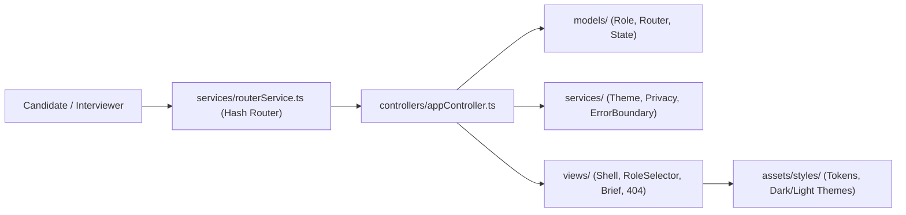

# InterviewX

Role-based technical interview assessment platform hosted statically on GitHub Pages. Built with strict MVC architecture, dark/light graphite design tokens, privacy-first local persistence, and automated quality gates.

## Supported Roles

| ID | Role | Focus |
|---|---|---|
| `fresh` | Fresh Graduate | Logic, basic SQL, networking, OS, aptitude, communication |
| `senior` | Senior Engineer | Architecture, trade-offs, performance, mentoring, incident leadership |
| `pm` | Project Manager | Scope, schedule, risk, stakeholders, change control |
| `dev` | Developer | Web/backend, MVC, APIs, JS/Node, debugging, code review |
| `sa` | System Analyst | Requirements, BRD/FRD, UML/flowcharts, UAT, gap analysis |
| `qa` | Quality Assurance | Test design, automation, defect triage, regression |
| `dba` | Database Admin (Oracle 12c) | Privileges, backup/RMAN, tuning, locks, RCA |

## Architecture (Strict MVC)



- `/models` — Domain models and TypeScript definitions
- `/views` — Safe DOM view renderers (zero raw `innerHTML`, zero inline handlers)
- `/controllers` — Route orchestration and application entry point
- `/services` — Hash router, theme service, privacy/data clearing, global error boundary
- `/data` — Role profiles, schemas, question banks, SQL datasets (Phase 2)
- `/assets` — CSS design tokens, dark/light themes, per-role accents
- `/tests` — Unit (`tests/unit`) and Accessibility/E2E (`tests/a11y`, `tests/e2e`)
- `/scripts` — Cross-platform Node ESM scripts (100% PowerShell-compatible)

## Running on Windows 11 (PowerShell)

**Prerequisites**: Node.js `22.13.0` (or compatible Node 22.x)

```powershell
# 1. Install dependencies
npm ci

# 2. Start local dev server
npm run dev

# 3. Run quality gates (Phase 2 includes bank integrity + >=85% coverage)
npm run validate:bank
npm run test:coverage
npm run gate:p2
```

## Privacy & Security

- **100% client-side**: All progress and diagnostics stay in your browser. No tracking or backend calls.
- **Clear All My Data**: Available in the footer to wipe `localStorage`, `sessionStorage`, `IndexedDB`, and browser caches.
- **Strict CSP**: Enforced via `<meta http-equiv="Content-Security-Policy">` with zero inline scripts or styles and self-hosted fonts.
- **Answer-key hygiene**: MCQ/multi-select answers use SHA-256 hashes and reference SQL/code keys are obfuscated. Because a static site cannot be fully cheat-proof against determined inspection, supervised interviews should use Interviewer Mode (Phase 4).

## Roadmap Status

- [x] **Phase 1**: Audit, strict MVC architecture, design system, 7-role selector & brief shell, hash router, error boundary, CI skeleton
- [x] **Phase 2**: 7 JSON role profiles, 168 tagged questions (2× pool enforced), weighted assessment engine, timer & persistence/multi-tab services, automated Content QA (`sql.js` verified), ≥ 85% unit coverage
- [ ] **Phase 3**: Lazy-loaded SQL (`sql.js`) & sandboxed Code runners, scoring, SVG radar chart, PDF/JSON round-trip export, signed share code
- [ ] **Phase 4**: Lazy-loaded Three.js per-role scenes + 2D fallback, Interviewer Mode, PWA/offline, security hardening, Lighthouse ≥ 90
- [ ] **Phase 5**: Full UAT checklist, runbook, documentation, `v1.0.0` release tag
