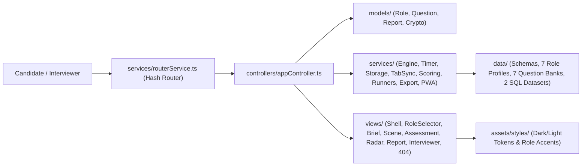

# InterviewX

**InterviewX** is a static, privacy-first, role-based technical interview assessment platform hosted on GitHub Pages. It evaluates candidates across **8 specialized tracks** with weighted question assembly, interactive in-browser SQL (`sql.js`) and sandboxed Web Worker JavaScript runners, SVG radar competency reports, checksummed JSON/PDF export, tamper-evident shareable result codes, lazy-loaded Three.js per-role motifs (with 2D fallback), and a PIN-gated Interviewer Mode.

## Supported Roles (192 Verified Questions · 2× Pool Enforced)

| ID | Role | Focus |
|---|---|---|
| `fresh` | Fresh Graduate | Logic, basic SQL, networking, OS, aptitude, communication |
| `senior` | Senior Engineer | Architecture, trade-offs, performance, mentoring, incident leadership |
| `pm` | Project Manager | Scope, schedule, risk, stakeholders, change control |
| `dev` | Developer | Web/backend, MVC, APIs, JS/Node, debugging, code review |
| `sa` | System Analyst | Requirements, BRD/FRD, UML/flowcharts, UAT, gap analysis |
| `qa` | Quality Assurance | Test design, automation, defect triage, regression |
| `dba` | Database Admin (Oracle 12c) | Privileges, backup/RMAN, tuning, locks, RCA |
| `ba` | Business Analyst | Discovery & elicitation, business case & ROI, KPI/SQL analytics, backlog prioritization |

## Architecture (Strict MVC)



- `/models` — Domain models, SHA-256 hashing & obfuscation helpers
- `/views` — Safe DOM renderers (zero raw `innerHTML`, zero inline handlers), SVG radar chart, lazy Three.js + 2D fallback scenes
- `/controllers` — Route orchestration (`appController.ts`) and entry point (`main.ts`)
- `/services` — Hash router, weighted assessment engine, drift-corrected timer, IndexedDB/localStorage/memory store, multi-tab sync, lazy `sql.js` & sandboxed Web Worker JS runners, scoring, PDF/JSON/share-code exporter, PWA registration, error boundary
- `/data` — JSON schemas, 7 role profiles, 7 tagged question banks, 2 relational SQL datasets
- `/assets` — Dark graphite + light CSS custom-property design tokens and 7 per-role accents
- `/tests` — Unit (`tests/unit`), Integration (`tests/integration`), Accessibility (`tests/a11y`), E2E (`tests/e2e`), Visual Baselines (`tests/visual`)
- `/scripts` — Cross-platform Node ESM scripts (100% PowerShell-compatible)

## Running on Windows 11 (PowerShell)

**Prerequisites**: Node.js `22.13.0` (or compatible Node 22.x)

```powershell
# 1. Install pinned dependencies
npm ci

# 2. Start local dev server
npm run dev

# 3. Run individual verification commands
npm run lint              # ESLint
npm run typecheck         # TypeScript strict check
npm run validate:bank     # JSON schemas, 2x pool coverage, duplicate check, sql.js SQL verification
npm run test:coverage     # Vitest unit & integration tests (>= 85% on /models & /services)
npm run build             # Self-host sql-wasm.wasm + Vite production build
npm run check:budget      # Enforce < 200 KB gzip initial JS budget
npx playwright install chromium
npm run test:a11y         # axe-core WCAG 2.2 AA & CSP baseline
npm run test:e2e          # All 7 roles happy path + negative paths + Phase 4 edge cases

# 4. Run full quality gate
npm run gate:p4
```

## Security & Privacy

- **100% client-side**: All answers, notes, and diagnostics stay locally in the browser (`IndexedDB` / `localStorage`). No tracking, cookies, or backend uploads.
- **Clear All My Data**: Footer action wipes `localStorage`, `sessionStorage`, `IndexedDB`, and CacheStorage.
- **Strict CSP**: Enforced via `<meta http-equiv="Content-Security-Policy">` with zero `'unsafe-inline'` scripts/styles and self-hosted fonts & WASM.
- **Sandboxed Code Execution**: JavaScript coding tasks run inside an isolated Web Worker with network/import APIs stripped, a 1.5s execution timeout, and an output memory guard.
- **Honest Static-Site Security Note**: Answer keys are SHA-256 hashed / obfuscated and Interviewer Mode uses a PIN gate (default demo PIN: `2026`). Because static client-side apps cannot be 100% cheat-proof against determined DevTools inspection, use Interviewer Mode during supervised live interviews.

## Deployment (GitHub Pages)

Pushes to `main` automatically run `.github/workflows/ci.yml` (`secret-scan → lint → typecheck → validate:bank → test:coverage → build → budget → e2e → a11y → lighthouse → deploy`). Ensure repository **Settings → Pages → Source** is set to **GitHub Actions**.

## Additional Documentation

- [`CONTRIBUTING.md`](CONTRIBUTING.md) — How to add a role or question and run validation
- [`QUESTION-AUTHORING.md`](QUESTION-AUTHORING.md) — Authoring standards and quality checklist
- [`RUNBOOK.md`](RUNBOOK.md) — Deployment, rollback, and troubleshooting procedures
- [`UAT-CHECKLIST.md`](UAT-CHECKLIST.md) — 7-role manual UAT, Go/No-Go checklist, and S1–S4 defect log template
- [`CHANGELOG.md`](CHANGELOG.md) — Release history (`v1.0.0`)
- [`LICENSE`](LICENSE) — MIT License
